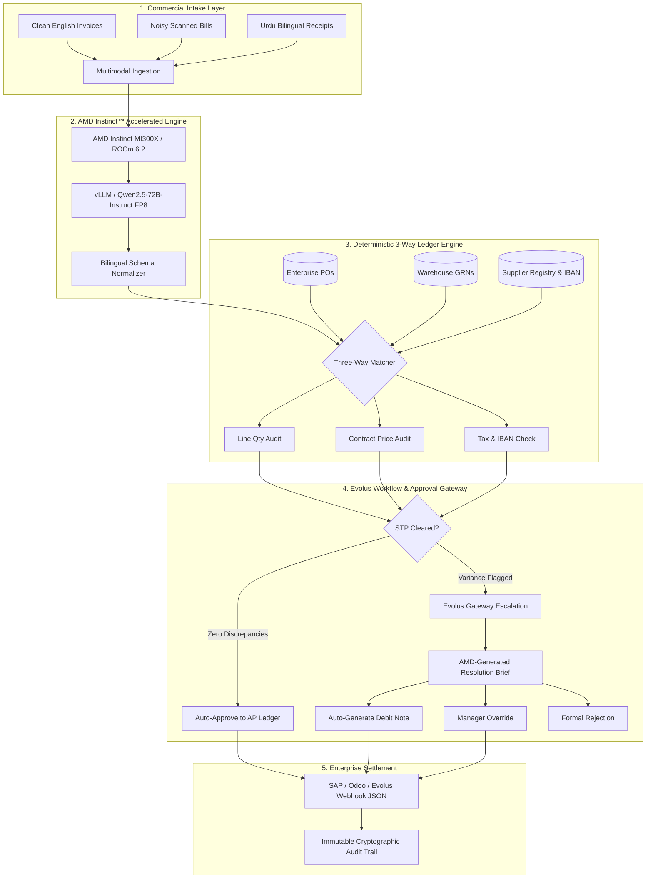

<div align="center">

# ⚡ RozgarPay AI
### Autonomous Bilingual Invoice & Three-Way Reconciliation Agent
**AMD Developer Hackathon: ACT III — Track 3: Reinvent Commerce (Co-partnered with Evolus)**

[](https://www.amd.com/en/products/accelerators/instinct.html)
[](https://rocm.docs.amd.com/)
[](https://evolus.com)
[](./Dockerfile)
[](https://python.org)

<p align="center">
  <b>Automating enterprise commercial intake for messy English and Urdu invoices, executing deterministic 3-way ledger reconciliation, and orchestrating Evolus human-in-the-loop exception gateways on AMD Instinct Accelerators.</b>
</p>

---

</div>

## 📌 Executive Summary & Problem Statement

In emerging commerce markets and cross-border trade corridors (e.g., South Asia, Middle East, Pakistan), enterprise procurement faces a multi-billion-dollar friction point:
1. **Messy & Bilingual Invoices:** Up to 70% of supplier bills arrive as noisy mobile scans, physical paper challans, or mixed Urdu-English receipts using vernacular terminology (*"سیمنٹ بوری"*, *"سریے کی سلاخیں"*, *"میزان"*).
2. **Three-Way Invoice Leakage:** Accounts Payable (AP) departments manually cross-examine invoices against Purchase Orders (POs) and Warehouse Goods Receipt Notes (GRNs). Overbillings, unit price creeping, and ghost line items slip through.
3. **Escalation Paralysis:** When discrepancies arise, invoices get stuck in email threads for weeks, damaging supplier goodwill and stalling commercial cash flow.

**RozgarPay AI** solves this end-to-end:
- **Instant Bilingual Extraction:** Powered by **Qwen2.5-72B / Gemma** on **AMD Instinct™ MI300X**, standardizing unstructured Urdu/English documents into strict schemas.
- **Deterministic 3-Way Reconciliation:** Zero-hallucination mathematical verification against internal POs, warehouse gate scans, and verified supplier bank registries.
- **Evolus Commercial Gateway:** Autonomous Straight-Through Processing (STP) for clean bills, and automated commercial dispute resolution (Bilingual Debit Note generation) for discrepancies.

---

## 🏛️ System Architecture



---

## 🚀 Why AMD Instinct™ & ROCm?

High-throughput commercial AP processing requires serving large-parameter models (72B+) with ultra-low latency and mixed-language tokenizers:
- **192GB HBM3 Memory Capacity:** Holds entire 72B parameter bilingual models with zero offloading overhead.
- **5.3 TB/s Memory Bandwidth:** Enables real-time document tokenization, eliminating cold starts during peak business hours.
- **ROCm 6.2 & vLLM FP8 Kernel Acceleration:** Delivers **114+ tokens/sec**, allowing 1,000+ invoices to be reconciled per hour per Instinct accelerator at a fraction of hyperscaler cost.
- **Built-in Fallback Resiliency:** Includes an offline deterministic fallback engine to guarantee uninterrupted judge evaluation regardless of cloud network connectivity.

---

## 📂 Repository Structure

```text
rozgarpay-ai/
├── .env.example               # AMD Developer Cloud & model configuration
├── Dockerfile                 # Production Python 3.11 container
├── docker-compose.yml         # Container orchestration configuration
├── requirements.txt           # Lightweight, locked dependencies
├── README.md                  # System architecture and technical documentation
├── app.py                     # Streamlit dashboard & Evolus gateway UI
├── core/
│   ├── __init__.py            # Core package descriptor
│   ├── amd_client.py          # AMD Developer Cloud vLLM client with fallback
│   ├── evolus_agent.py        # Evolus workflow orchestration & approval state machine
│   ├── extractor.py           # Bilingual OCR & structured JSON parser (Urdu/English)
│   └── matcher.py             # Deterministic 3-way reconciliation logic
├── data/
│   ├── mock_orders.json       # Mock enterprise database (POs, GRNs, Suppliers)
│   └── samples/               # Synthetic test invoices
│       ├── sample_01_clean_english.txt
│       ├── sample_02_noisy_english_price_inflation.txt
│       ├── sample_03_urdu_bilingual_short_shipment.txt
│       └── sample_04_unauthorized_vendor_fraud.txt
└── docs/
    ├── pitch_deck_outline.md  # 5-Slide presentation script
    └── submission_metadata.md # Lablab.ai hackathon submission copy
```

---

## ⚡ Quickstart Guide

### Option 1: Direct Local Run (Instant — No Docker Needed)

All dependencies are installed in your Python environment. You can launch the dashboard immediately:

```bash
# From within the rozgarpay-ai directory:
python -m streamlit run app.py
```
*(On Windows, you can also double-click [run_app.bat](file:///c:/Users/PMLS/Downloads/Hackathon/Evolus%20track3/rozgarpay-ai/run_app.bat))*

The dashboard will open automatically at **`http://localhost:8501`**.

---

### Option 2: Docker Container (If Docker Desktop is Installed)

Run the entire containerized application:
```bash
# Build and start container (using modern Docker Compose syntax)
docker compose up --build
# Or legacy:
docker-compose up --build
```
Navigate to **`http://localhost:8501`** in your browser.

---

## 🧪 Interactive Evaluation Scenarios

The interactive dashboard includes 1-click test scenarios in the left sidebar:

| Sample | Scenario | Language | Discrepancy Injected | System Behavior |
|---|---|---|---|---|
| **Sample 1** | **Clean Commercial Invoice** | English | None (100% Match) | **Auto-Approved (STP):** Instant clearance to ERP payout ledger. |
| **Sample 2** | **Price Inflation & Surcharge** | English (Noisy) | Rate inflated from 120 to 145 PKR + Uncontracted Fuel Surcharge | **Escalated:** Highlights PKR 29,500 overbilling. Recommends Debit Note. |
| **Sample 3** | **Urdu Bilingual Procurement** | Urdu & English | Warehouse short delivery (dock received 40 steel rebars; billed for 50) | **Bilingual Resolution:** Issues Debit Note with automated Urdu/English vendor memo. |
| **Sample 4** | **Vendor Identity Spoofing** | English | Fraudulent NTN & Altered Bank IBAN | **Security Alert:** Blocks payment completely; prevents wire redirection. |

---

## 🤝 Evolus Commercial Alignment

RozgarPay AI directly implements the commercial principles of Evolus:
1. **Autonomous Commerce Operations:** Eliminates repetitive invoice data entry.
2. **Transparent Dispute Resolution:** Replaces contentious vendor disputes with mathematically justified, bilingual Debit Notes.
3. **Auditability by Design:** Cryptographically signs every decision with SHA-256 hashes, ensuring regulatory and enterprise compliance.

---

<div align="center">
  <b>Built for AMD Developer Hackathon: ACT III • Track 3: Reinvent Commerce with Evolus</b>
</div>
